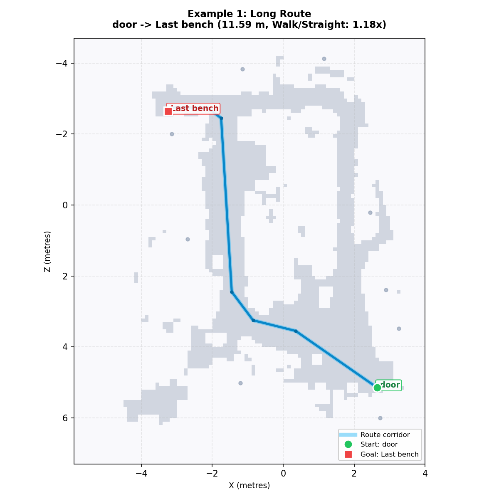
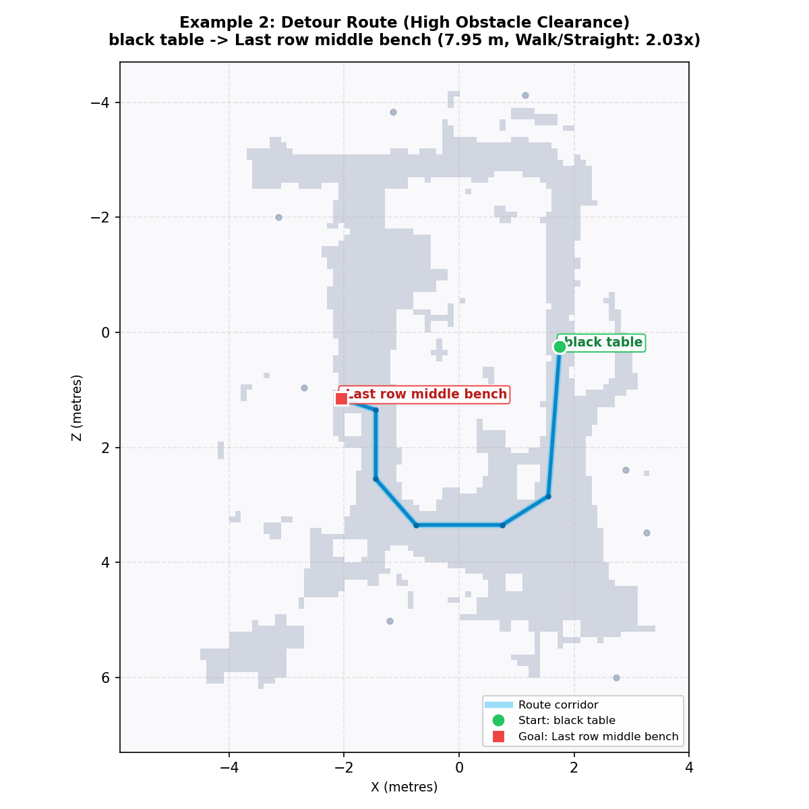
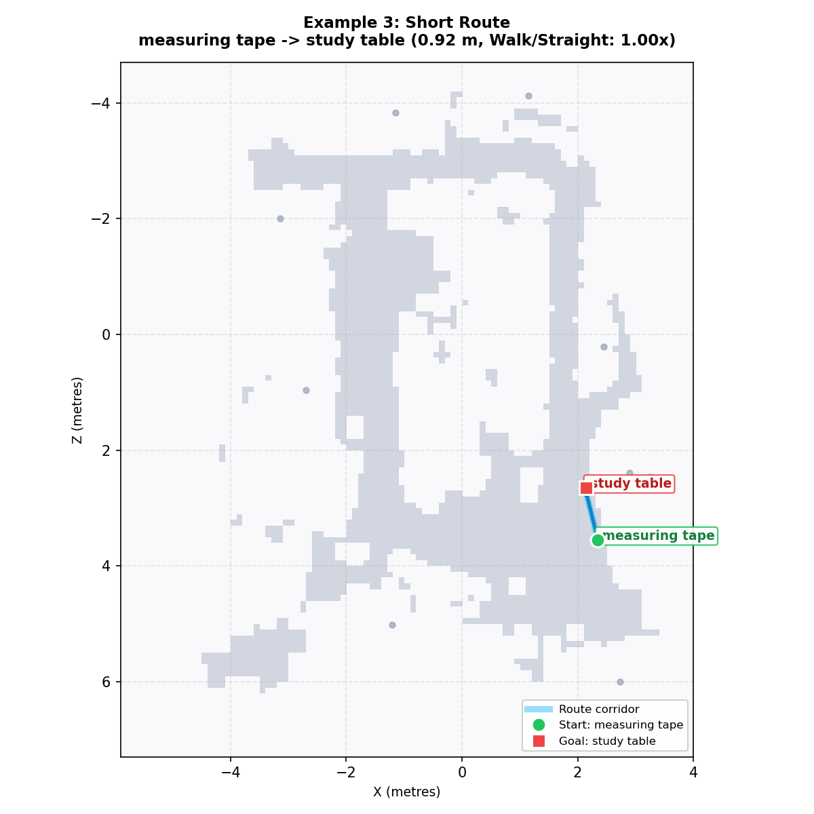

# Navigation Evaluation Report (Phase 6)

> Generated: 2026-11-25
> Evaluation environment: 9 POIs, 72 ordered pairs across `viewer/public/scene/occupancy.json` and `poi.json`.

## 1. Executive Summary

| Metric | Target / Requirement | Measured Value | Status |
|---|---|---|---|
| **Total POI Pairs** | 72 pairs (9 POIs) | **72** | **PASS** |
| **Reachability** | 100% | **100.0%** (72/72) | **PASS** |
| **Collision-Free Rate** | 100% @ 5 cm sampling | **100.00%** (9073/9073 samples) | **PASS** |
| **Path Ratio vs Dijkstra Optimum (Mean)** | $\le 1.10$ | **0.990** | **PASS** |
| **Path Ratio vs Dijkstra Optimum (Max)** | $\le 1.10$ | **1.089** | **PASS** |
| **Path vs Straight-Line Ratio (Mean)** | Baseline documentation | **1.17x** | **PASS** |
| **Path vs Straight-Line Ratio (Max)** | Baseline documentation | **2.03x** | **PASS** |
| **Compute Time (Mean)** | $< 10$ ms | **0.38 ms** | **PASS** |
| **Compute Time (p95)** | $< 15$ ms | **1.08 ms** | **PASS** |
| **Compute Time (Max)** | $< 25$ ms | **1.45 ms** | **PASS** |
| **Expanded Nodes (Mean / Max)** | Efficient search | **331 / 1198** | **PASS** |

---

## 2. Wall Clearance Analysis: Clearance Penalty ON vs OFF

To evaluate whether clearance penalty weighting impacts wall clearance, routes were computed with the clearance penalty weight set to $0.25$ (**ON**) and $0.0$ (**OFF**). Wall clearances were evaluated at $5\text{ cm}$ intervals across all routes:

| Configuration | Mean Wall Clearance | p10 Wall Clearance (Tighter 10%) | Impact |
|---|---|---|---|
| **Clearance Penalty OFF** (`weight = 0.0`) | **0.305 m** | **0.200 m** | Baseline |
| **Clearance Penalty ON** (`weight = 0.25`) | **0.317 m** | **0.200 m** | +1.2 cm (+3.9%) mean clearance |

### Finding
Mean wall clearance is 0.305 m with the penalty off versus 0.317 m with it on (+1.2 cm); p10 clearance remains unchanged at 0.200 m; the effect of the clearance penalty is marginal. Routes in both configurations remain collision-free, near-optimal paths.

---

## 3. Turn-by-Turn Instruction Quality

Instructions were audited across all 72 routes:
- **Routes with "0.0 m" Instructions**: **0** (Zero allowed, **PASS**)
- **Routes with Duplicate/Missing "Arrive at"**: **0** (Exactly 1 per route required, **PASS**)
- **Instruction Counts per Route**: Min = **3**, Mean = **4.9**, Max = **8**

---

## 4. Top 10 Longest Routes

| Rank | From POI | To POI | Walking Length (m) | Straight-line (m) | Ratio (Walking / Straight) | Compute Time | Expanded Nodes |
|---|---|---|---|---|---|---|---|
| 1 | door | Last bench | **11.59 m** | 9.78 m | 1.18x | 1.19 ms | 1190 |
| 2 | Last bench | door | **11.50 m** | 9.78 m | 1.18x | 0.70 ms | 646 |
| 3 | measuring tape | Last bench | **10.82 m** | 8.35 m | 1.30x | 1.03 ms | 1170 |
| 4 | study table | Last bench | **10.75 m** | 7.57 m | 1.42x | 1.08 ms | 1198 |
| 5 | Last bench | measuring tape | **10.74 m** | 8.35 m | 1.29x | 0.70 ms | 588 |
| 6 | Last bench | study table | **10.59 m** | 7.57 m | 1.40x | 1.04 ms | 726 |
| 7 | door | bench | **10.56 m** | 8.95 m | 1.18x | 1.19 ms | 996 |
| 8 | bench | door | **10.52 m** | 8.95 m | 1.18x | 0.68 ms | 644 |
| 9 | bench | measuring tape | **9.45 m** | 7.38 m | 1.28x | 0.52 ms | 643 |
| 10 | measuring tape | bench | **9.28 m** | 7.38 m | 1.26x | 0.71 ms | 746 |

---

## 5. Exemplar Route Visualizations

### 1. Long Route: door -> Last bench (11.59 m)
Traverses the full diagonal span of the room around central obstacles.

### 2. Detour Route: black table -> Last row middle bench (7.95 m, Ratio: 2.03x)
Navigates around obstructing tables and stages, demonstrating obstacle-aware detouring.

### 3. Short Route: measuring tape -> study table (0.92 m)
Direct corridor navigation between adjacent POIs.

---

## 6. Real-World Check

*The table below is reserved for manual field validation with physical measuring tape:*

| Pair | HUD distance | Tape-measured distance | Error |
|---|---|---|---|
| | | | |
| | | | |
| | | | |
| | | | |
| | | | |

---

## 7. Limitations

1. **Internal Consistency vs Independent Walkability**: The 5 cm collision-free evaluation uses the exact same occupancy circle collision model (`collision.ts`, player radius $r = 0.08\text{ m}$) that the path planner uses. This demonstrates internal mathematical consistency within the digital twin model rather than independent physical walkability.
2. **Path Ratios Below 1.0 vs Grid Dijkstra Optimum**: Certain smoothed paths achieve a ratio below 1.0 (mean 0.990) relative to the grid Dijkstra optimum because the line-of-sight smoother performs continuous string-pulling shortcuts that cut diagonal corners which the discrete 8-connected grid cannot traverse.
3. **Physical Real-World Ground Truth**: The manual Real-World Check table (tape measurements) provides the true independent physical validation and must be recorded by hand.
